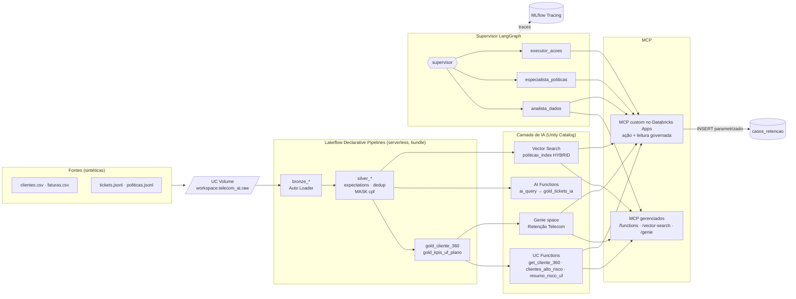

# Copiloto de Retenção Telecom: Databricks + IA + MCP + multiagentes

Pipeline de dados e sistema de agentes, ponta a ponta no Databricks, para reduzir churn numa operadora de telecom
brasileira (dados sintéticos). Arquivos brutos chegam num Volume do Unity Catalog, passam por um pipeline medalhão
(Lakeflow Declarative Pipelines, com expectations e máscara de CPF) e viram uma visão 360 do cliente com score de
risco. Sobre essa base, a camada de IA tem AI Functions, funções UC usadas como ferramentas, Vector Search e Genie.
Tudo é exposto por **MCP**: os servidores gerenciados do Databricks e um servidor MCP próprio publicado no
**Databricks Apps**. Um **supervisor LangGraph multiagente** usa esse MCP para responder, por exemplo,
*"pegue o cliente de maior risco em SP, explique o risco, diga a política aplicável e abra um caso"*. Ele grava o
caso de retenção numa tabela Delta, e cada passo fica rastreado no **MLflow Tracing**.

## Arquitetura



## Stack

| Camada | Tecnologia |
|---|---|
| Governança | Unity Catalog (`workspace.telecom_ai`): Volume, column mask `mask_cpf`, view governada, tags, comentários, lineage |
| Ingestão e ETL | Lakeflow Declarative Pipelines (`pyspark.pipelines`), Auto Loader, expectations, serverless |
| Orquestração e CI/CD | Declarative Automation Bundles (`databricks.yml`), Lakeflow Job diário |
| IA em SQL | AI Functions (`ai_query` com saída estruturada, Llama 3.3 70B) |
| Ferramentas de agente | SQL table functions no UC (comentários viram a descrição da ferramenta) |
| RAG | Mosaic AI Vector Search (Delta Sync, `databricks-gte-large-en`, consulta HYBRID) |
| Text-to-SQL | AI/BI Genie (criado via API, instruções e exemplos de SQL) |
| MCP | MCP gerenciados do Databricks + servidor `FastMCP` (`mcp==1.30.0`, Streamable HTTP) no Databricks Apps |
| Agentes | LangGraph (supervisor + 3 agentes ReAct), `databricks-langchain`, Foundation Model APIs |
| Observabilidade | MLflow Tracing (autolog do LangChain) |
| Linguagem | Python 3.12 (venv `uv`), SQL |

## Estrutura

```
data_gen/      gerador de dados sintéticos (seed 42) e checagem do sinal de churn
pipeline/      código do Lakeflow Declarative Pipeline (bronze/silver/gold)
resources/     pipeline e job do bundle      databricks.yml  bundle
sql/           setup (schema, volume, mask), governança, validação, executor de SQL
ai/            AI Functions, funções UC, Vector Search, Genie
mcp_server/    servidor MCP customizado (server.py, app.yaml) e deploy_app.py
agent/         supervisor multiagente (retencao_multiagente.py) e smoke test MCP (testar_mcp.py)
docs/          01_dados · 02_ia · 03_mcp_agentes · demo_transcript
```

## Como reproduzir

Pré-requisitos: Databricks CLI, `uv`, um workspace (o Free Edition basta) e um SQL warehouse serverless.

```powershell
# 0) ambiente e autenticação (OAuth U2M)
databricks auth login --host https://<workspace>.cloud.databricks.com --profile DEFAULT
py -3 -m uv venv --python 3.12 .venv
py -3 -m uv pip install --python .venv\Scripts\python.exe -r agent\requirements.txt
$env:DATABRICKS_WAREHOUSE_ID = "<warehouse_id>"

# 1) dados + setup UC (schema, volume, função de máscara: precisa existir antes do pipeline)
py -3 data_gen\gerar_dados.py
py -3 sql\executar_sql.py sql\01_setup.sql
foreach ($e in "clientes","faturas","tickets","politicas") {
  databricks fs cp -r --overwrite data_gen\output\$e dbfs:/Volumes/workspace/telecom_ai/raw/landing/$e }

# 2) pipeline medalhão via bundle
databricks bundle validate; databricks bundle deploy
databricks bundle run pipeline_retencao --full-refresh-all
py -3 sql\executar_sql.py sql\02_governanca.sql
py -3 sql\executar_sql.py sql\03_validacao.sql

# 3) camada de IA
py -3 sql\executar_sql.py ai\01_tickets_ia.sql     # AI Functions -> gold_tickets_ia
py -3 sql\executar_sql.py ai\02_funcoes_uc.sql     # funções UC (ferramentas)
py -3 ai\03_vector_search.py                        # endpoint vs-telecom + politicas_index
py -3 ai\04_genie_space.py                          # Genie space "Retenção Telecom"

# 4) servidor MCP customizado no Databricks Apps (grants mínimos ao SP + deploy)
.venv\Scripts\python.exe mcp_server\deploy_app.py --warehouse-id <warehouse_id>
.venv\Scripts\python.exe agent\testar_mcp.py        # smoke test de todos os MCP

# 5) demo multiagente (traces no MLflow)
.venv\Scripts\python.exe agent\retencao_multiagente.py --transcript docs\demo_transcript.md
```

## Links (workspace da demo)

- Pipeline: https://dbc-1d83b389-044f.cloud.databricks.com/pipelines/b5b70270-98dd-4ff5-b70e-a088d04c21fb
- Job diário: https://dbc-1d83b389-044f.cloud.databricks.com/jobs/1088903333559427
- Genie: https://dbc-1d83b389-044f.cloud.databricks.com/genie/rooms/01f1d2578a841c018d73b75bc354b90e
- App MCP: https://mcp-telecom-retencao-7474649343292730.aws.databricksapps.com/mcp
- MLflow (traces): https://dbc-1d83b389-044f.cloud.databricks.com/ml/experiments/2440743401552581/traces

## Resultados principais

- **Pipeline**: um update COMPLETED em cerca de 1 min (serverless). Bronze → silver: clientes 806 → 800,
  faturas 8.937 → 8.919, tickets 1.594 → 1.584. As expectations descartaram 18 linhas sujas, entre ids nulos,
  UF inválida, valores negativos e textos vazios. Resultado: `gold_cliente_360` com 800 clientes e
  `gold_kpis_uf_plano` com 55 linhas.
- **Score de risco com sinal real**: churn de 12,4% na faixa *baixo*, 31,0% na *médio* e **79,3%** na *alto*
  (média geral de 16,5%).
- **AI Functions**: 200 tickets classificados com `ai_query`, com **94,5%** de concordância com a categoria
  original e 0 erros de LLM.
- **Vector Search**: com HYBRID, a P003 (sinal) fica em 1º para "insatisfeito com sinal querendo cancelar". A busca
  ANN pura colocava a P015 em 1º.
- **Genie**: "5 UFs com maior receita em risco" retorna MG R$ 879,40 · PR · SP · RJ · CE, o mesmo resultado de
  `resumo_risco_uf()`.
- **Demo multiagente** (`databricks-meta-llama-3-3-70b-instruct`, cerca de 54 s): cliente **C00605** (Santos/SP,
  Pós Ilimitado, score 0,7648, 6 tickets em 90 dias, 4 deles críticos, "Sinal 4G inexistente dentro de casa") →
  política **P003** (visita técnica em 24h + crédito), com P014 e P004 como complementares → caso
  `e535da0d-ecfe-4665-a114-c0d9da18f2b1` (prioridade alta) gravado em `casos_retencao`. Transcrição completa em
  [`docs/demo_transcript.md`](docs/demo_transcript.md).

## Decisões técnicas e lições

- **HYBRID em vez de ANN**: o único embedding disponível é em inglês (gte-large-en), e a busca puramente semântica
  em pt-BR perde palavras-chave como "sinal". Por isso o MCP customizado expõe `buscar_politicas` com
  `query_type="HYBRID"`. Lição da demo: consultas longas diluem o componente keyword, então o especialista é
  instruído a fazer consultas curtas e focadas na causa raiz.
- **Instruções do Genie são o "fine-tuning" dele**: sem a instrução "gold_kpis_uf_plano é 1 linha por uf×plano →
  agregue", o Genie ranqueava linha a linha e errava o topo. Bastou 1 instrução + 1 SQL de exemplo para corrigir.
- **`mcp==1.30.0` fixado**: a versão 2.x renomeia `FastMCP` e quebra o `langchain-mcp-adapters` usado pelo
  `databricks-langchain`.
- **Máscara aplicada no próprio pipeline**: o `cpf STRING MASK mask_cpf` está no schema da tabela silver, então a
  PII nunca fica exposta, nem entre um deploy e outro. A função é criada no setup, antes do pipeline.
- **OAuth e menor privilégio**: o cliente usa OAuth U2M (sem PAT). O app roda como service principal próprio, que
  tem só `USE`/`SELECT`/`MODIFY`/`CREATE TABLE`/`EXECUTE` no schema, `CAN_USE` no warehouse e `CAN_RUN` no Genie
  (declarados como recursos do app). Não há segredo no código. O SQL é sempre parametrizado, então uma prompt
  injection não vira SQL injection.
- **Separação de poderes entre agentes**: o supervisor não acessa dados, e só o `executor_acoes` vê a ferramenta de
  escrita. As ferramentas são distribuídas por papel mesmo quando vêm do mesmo servidor.
- **Degradação elegante**: neste workspace Free Edition o Public Preview de MCP gerenciado está desligado
  (`NOT_FOUND`). O agente detecta isso e usa as ferramentas de leitura equivalentes do MCP customizado, sem mudar
  código. Com o preview ligado, o analista volta a usar o MCP gerenciado.
- **Particularidades do Free Edition**: o índice vetorial levou cerca de 17 min até ficar `ready`, e o compute do
  app é parado pela plataforma, o que exige rodar o `deploy_app.py` de novo antes de demonstrar.

## Roteiro de demo na entrevista (5 min)

1. **(30 s) Problema e arquitetura**: o diagrama acima. "Dados → governança → IA → MCP → agentes, tudo no UC."
2. **(1 min) Pipeline**: abrir o pipeline e mostrar o grafo bronze/silver/gold e as métricas de expectations
   (linhas descartadas). No Catalog Explorer, abrir `silver_clientes` e mostrar o CPF mascarado e a lineage.
3. **(1 min) IA no SQL**: `SELECT * FROM workspace.telecom_ai.clientes_alto_risco('SP', 5)` e `gold_tickets_ia`.
   No Genie, perguntar "Qual a receita mensal em risco por plano?" e mostrar o SQL gerado.
4. **(1,5 min) Agentes + MCP**: rodar `agent\retencao_multiagente.py` ao vivo. Narrar supervisor → analista
   (C00605, sinal 4G) → políticas (P003, HYBRID) → executor (caso aberto). Em seguida, `SELECT * FROM casos_retencao`.
5. **(1 min) Observabilidade e segurança**: abrir o trace no MLflow (árvore de chamadas, latência, tool calls). No
   app, mostrar o SP e os grants mínimos, o SQL parametrizado e a decisão HYBRID vs ANN.

Checklist antes da entrevista: `databricks auth login` válido, warehouse ligado, rodar `deploy_app.py` (o app
para sozinho no Free Edition), `agent\testar_mcp.py` OK e, se possível, ligar *Managed MCP servers* em
Settings → Previews.
