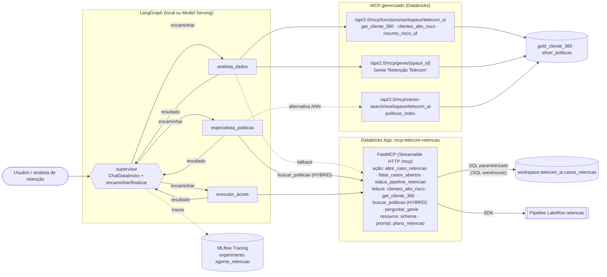

# 03 — MCP e sistema multiagente

Camada de agentes do Copiloto de Retenção Telecom. Um **supervisor LangGraph** coordena três especialistas, e cada um acessa o Databricks **somente por MCP (Model Context Protocol)**:

- MCP **gerenciado** pelo Databricks para leitura e análise: funções do Unity Catalog, Vector Search e Genie;
- MCP **customizado**, um servidor próprio publicado como Databricks App, para ações de escrita controladas
  **e** para leitura governada quando o MCP gerenciado não é a melhor opção (busca HYBRID de políticas) ou não está
  habilitado no workspace (fallback automático — ver "Resultados").

## Arquitetura



| Papel | Ferramentas MCP | Permissão efetiva |
|---|---|---|
| `supervisor` | nenhuma (só `encaminhar` / `finalizar`) | não acessa dados |
| `analista_dados` | UC Functions + Genie (gerenciado); fallback: `clientes_alto_risco`, `get_cliente_360`, `perguntar_genie` do app | leitura (EXECUTE nas funções, SELECT nas tabelas gold) |
| `especialista_politicas` | `buscar_politicas` do app (Vector Search **HYBRID**); alternativa: MCP gerenciado de Vector Search | leitura do índice de políticas |
| `executor_acoes` | app MCP customizado (só `abrir_caso_retencao`, `listar_casos_abertos`, `status_pipeline_retencao`) | **escrita**, apenas pela ferramenta `abrir_caso_retencao` |

A distribuição é feita por `selecionar_ferramentas()` em `agent/retencao_multiagente.py`: cada especialista recebe
só o subconjunto de ferramentas do seu papel, mesmo quando todas vêm do mesmo servidor MCP.

Cada especialista é um agente ReAct (`langchain.agents.create_agent`). O supervisor delega um passo por vez, com uma instrução autocontida, e encerra com `finalizar`. O grafo usa checkpointer (`InMemorySaver` + `thread_id`), `recursion_limit=40` e um limite de 8 delegações.

## Arquivos

| Caminho | O que é |
|---|---|
| `mcp_server/server.py` | Servidor MCP customizado (SDK oficial `mcp`, `FastMCP`, Streamable HTTP em `0.0.0.0:$DATABRICKS_APP_PORT/mcp`, stateless) |
| `mcp_server/app.yaml` | Comando do app e variáveis; `DATABRICKS_WAREHOUSE_ID` vem do recurso `sql-warehouse` (`valueFrom`) |
| `mcp_server/requirements.txt` | Dependências do app (`mcp==1.30.0`, `databricks-sdk`, `uvicorn`) |
| `mcp_server/deploy_app.py` | Deploy idempotente: cria o app, concede grants ao SP, cria a tabela, envia o código e faz `apps deploy` |
| `agent/retencao_multiagente.py` | Supervisor LangGraph com 3 especialistas, MLflow Tracing e transcrição |
| `agent/testar_mcp.py` | Smoke test de todos os servidores MCP com `DatabricksMCPClient` |
| `agent/requirements.txt` | Versões fixadas do ambiente local (Python 3.12) |

## Como rodar

```powershell
# 1) ambiente (Python 3.12 via uv)
py -3 -m pip install --user uv
py -3 -m uv venv --python 3.12 .venv
py -3 -m uv pip install --python .venv\Scripts\python.exe -r agent\requirements.txt

# 2) autenticação OAuth U2M (a CLI precisa estar no PATH)
databricks auth login --host https://<seu-workspace>.cloud.databricks.com --profile DEFAULT
$env:DATABRICKS_CONFIG_PROFILE = "DEFAULT"     # opcional; o padrão já é DEFAULT

# 3) deploy do servidor MCP customizado
.venv\Scripts\python.exe mcp_server\deploy_app.py --warehouse-id <warehouse_id>

# 4) smoke test dos MCPs (managed + app); --abrir-caso também grava um caso de teste
.venv\Scripts\python.exe agent\testar_mcp.py --abrir-caso

# 5) demo ponta a ponta
.venv\Scripts\python.exe agent\retencao_multiagente.py --transcript docs\demo_transcript.md
# LLM alternativo, caso o tool-calling do Llama fique instável:
$env:LLM_ENDPOINT = "databricks-gpt-oss-120b"   # ou databricks-qwen3-next-80b-a3b-instruct
```

Para testar o servidor localmente, sem o Apps:

```powershell
$env:DATABRICKS_WAREHOUSE_ID="<id>"; $env:DATABRICKS_APP_PORT="8765"
.venv\Scripts\python.exe mcp_server\server.py      # http://127.0.0.1:8765/mcp
```

Nenhuma URL de workspace fica fixa no código. O host vem do perfil (`DATABRICKS_CONFIG_PROFILE`), a URL do app é descoberta com `w.apps.get("mcp-telecom-retencao")`, o Genie space é localizado pelo título e o experimento MLflow fica em `/Users/<usuário atual>/retencao_ai_mcp/agente_retencao`, ou no caminho definido em `MLFLOW_EXPERIMENTO`.

## URLs MCP

| Servidor | URL |
|---|---|
| UC Functions (gerenciado) | `{host}/api/2.0/mcp/functions/workspace/telecom_ai` |
| Vector Search (gerenciado) | `{host}/api/2.0/mcp/vector-search/workspace/telecom_ai` (alternativa testada: `/api/2.0/mcp/ai-search/...`) |
| Genie (gerenciado) | `{host}/api/2.0/mcp/genie/{space_id}` |
| Customizado (Databricks App) | `https://mcp-telecom-retencao-<id>.<região>.databricksapps.com/mcp` |

## Modelo de autenticação e autorização

1. **Cliente → MCP gerenciado**: OAuth U2M do usuário, pelo perfil da CLI. `DatabricksMCPClient` e `DatabricksMCPServer` montam o token a partir do `WorkspaceClient`. As permissões do UC são avaliadas **como o usuário**: EXECUTE nas funções, SELECT nas tabelas, acesso ao índice e ao Genie space.
2. **Cliente → app customizado**: o proxy do Databricks Apps exige um token OAuth do workspace. Só chega ao servidor quem tem **CAN_USE** no app (o dono já tem). Para liberar outra pessoa, use `databricks apps update-permissions` ou a aba *Permissions* do app.
3. **App → dados**: o servidor usa o **service principal do app** (credenciais injetadas, sem nenhum segredo no código), com o mínimo de privilégios:
   - `USE CATALOG` em `workspace`;
   - `USE SCHEMA`, `SELECT`, `MODIFY`, `CREATE TABLE` e `EXECUTE` em `workspace.telecom_ai`
     (SELECT no schema cobre o índice `politicas_index`; EXECUTE cobre as funções UC);
   - `CAN_USE` no SQL warehouse, como recurso `sql-warehouse` do app;
   - `CAN_RUN` no Genie space, como recurso `genie-space` do app (`GENIE_SPACE_ID` via `valueFrom`);
   - `CAN_VIEW` no pipeline `*retencao*`, para a ferramenta de status.

## Decisões de segurança

- **SQL sempre parametrizado** (`:param` na Statement Execution API). O texto gerado pelo LLM nunca é concatenado ao SQL, o que impede que uma prompt injection vire SQL injection.
- **Validação de entrada** no servidor: `prioridade` precisa estar em {baixa, media, alta, critica}; `cliente_id` tem no máximo 64 caracteres; `motivo` e `oferta` são cortados em 1000 caracteres; `limite` fica entre 1 e 100.
- **Separação de poderes**: somente o `executor_acoes` enxerga a ferramenta de escrita, e o supervisor não tem ferramentas de dados.
- **Superfície mínima de escrita**: o MCP customizado não executa SQL livre, só operações de negócio fechadas.
- **Auditoria**: cada caso grava `origem='agente_mcp'` e `criado_em`, e cada execução do agente gera um trace no MLflow.
- **Transporte stateless** (`stateless_http=True`), sem sessão presa a uma réplica do app.

## Versões e compatibilidade

- `mcp` está fixado em **1.30.0**. A versão 2.x renomeou `FastMCP` para `MCPServer` e quebrou o `langchain-mcp-adapters` 0.3.1 (`ImportError: RequestContext`), do qual o `databricks-langchain` depende.
- Ambiente local: Python 3.12 (venv `uv`). Em 3.14 algumas dependências (mlflow e langgraph) ainda não são suportadas.

## Decisão: busca de políticas HYBRID no MCP customizado

O índice `politicas_index` usa `databricks-gte-large-en` (embedding em inglês). Em pt-BR a busca ANN pura ranqueia
mal: para *"cliente insatisfeito com sinal querendo cancelar"* ela traz P015 (cancelamento) em 1º e perde "sinal";
com `query_type="HYBRID"` (vetor + palavra-chave) a P003 (visita técnica por sinal) vem em 1º (doc 02).
Por isso o servidor customizado expõe `buscar_politicas(consulta, k=3)`, que chama
`w.vector_search_indexes.query_index(..., query_type="HYBRID")` como o SP do app (SELECT herdado do schema).
O MCP gerenciado de Vector Search continua como alternativa (é usado automaticamente se o app cair).

Segunda lição, vista na demo: o componente keyword do HYBRID se dilui com consultas longas. Na 1ª execução o
especialista mandou o perfil inteiro do cliente como consulta e escolheu P011 (desconto); depois de instruí-lo a
fazer consultas **curtas e focadas na causa raiz** (`"problema de sinal 4G"`), a P003 veio em 1º.

## Resultados

### Workspace atual (dbc-1d83b389-044f, 28/10/2026)

| Item | Status |
|---|---|
| `deploy_app.py` (app, grants, recursos warehouse + Genie, upload, deploy) | OK: deploy SUCCEEDED, "App started successfully" |
| URL do app | `https://mcp-telecom-retencao-7474649343292730.aws.databricksapps.com/mcp` |
| Service principal do app | `app-ordyk7 mcp-telecom-retencao` (`a6c38862-6968-4ea8-8d45-27c8589bc005`) |
| `list_tools` no app via `DatabricksMCPClient` (OAuth U2M) | OK: 7 ferramentas |
| `clientes_alto_risco('SP', 2)` | OK: C00605 (score 0.7648), C00459 (0.6176) |
| `get_cliente_360('C00605')` | OK: Pós Ilimitado, Santos, 6 tickets/90d (4 críticos), último "Sinal 4G inexistente…" |
| `buscar_politicas('cliente reclama de sinal fraco e quer cancelar')` | OK: **P003** em 1º (0.962) |
| `perguntar_genie('Qual a taxa de churn por UF?')` | OK: SQL agregado sobre `gold_kpis_uf_plano`; PE 23,9% · BA 22,1% · PR 20,8% |
| `abrir_caso_retencao` / `listar_casos_abertos` / `status_pipeline_retencao` | OK |
| MCP gerenciado `/api/2.0/mcp/functions/workspace/telecom_ai` | **NOT_FOUND**: *"Databricks managed MCP servers are not enabled. Please ensure that Public Preview for this feature is enabled."* |
| MCP gerenciado `/api/2.0/mcp/vector-search/workspace/telecom_ai` e `/ai-search/...` | **NOT_FOUND** (mesma mensagem) |
| MCP gerenciado `/api/2.0/mcp/genie/01f1d2578a841c018d73b75bc354b90e` | **NOT_FOUND** (mesma mensagem) |
| Demo multiagente (`databricks-meta-llama-3-3-70b-instruct`) | **OK**: C00605 → P003 (+P014, P004) → caso `e535da0d-ecfe-4665-a114-c0d9da18f2b1` (prioridade alta) gravado em `casos_retencao`; ver `docs/demo_transcript.md` |
| MLflow Tracing | OK: traces no experimento `2440743401552581` (status OK, ~54 s por execução) |

Os MCP gerenciados dependem de um **Public Preview** que está desligado neste workspace Free Edition e não há API
para ligá-lo (é o toggle *Managed MCP servers* em **Settings → Previews**, feito por admin na UI). O agente trata isso
sem mudança de código: `carregar_ferramentas()` registra o erro e `selecionar_ferramentas()` entrega ao analista as
ferramentas de leitura equivalentes do app (mesmas funções UC, mesmo Genie space). Quando o preview for ligado, o
analista passa a usar o MCP gerenciado automaticamente.

Observação operacional: no Free Edition o compute do app é parado (*"App compute was stopped due to workspace or
account status"*) e volta sem deployment ativo; antes da demo rode `deploy_app.py` de novo (≈3–5 min).
